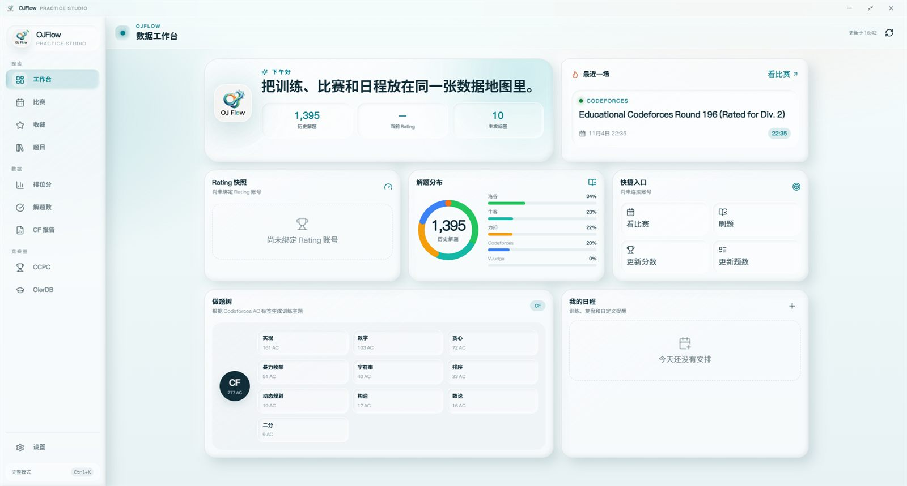
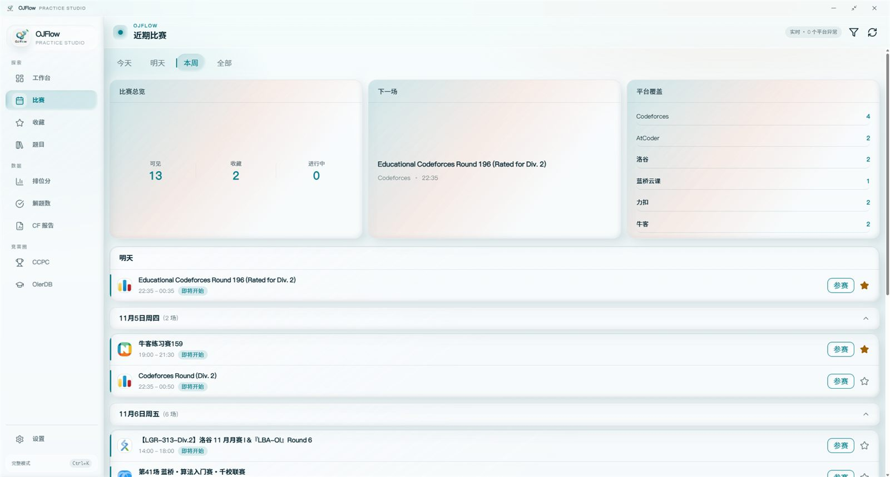
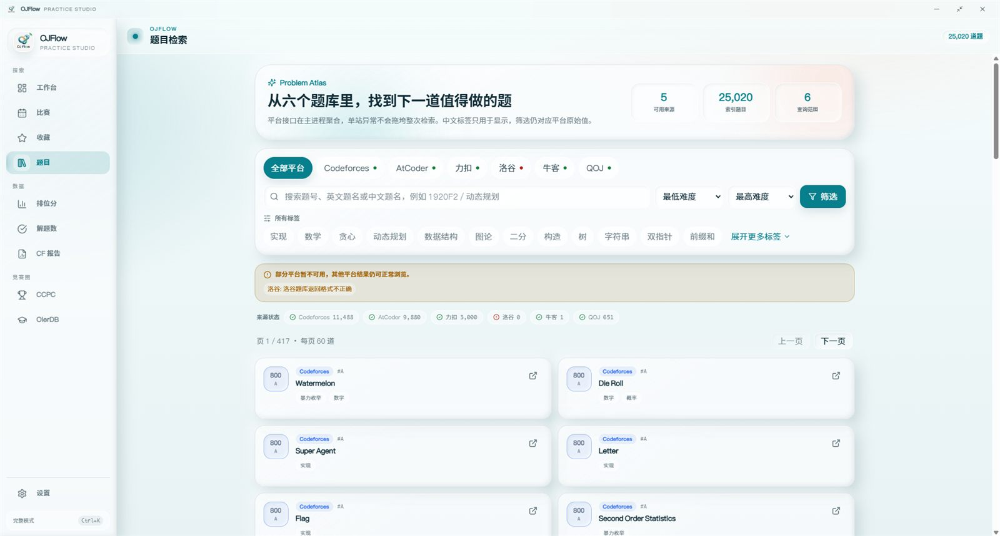
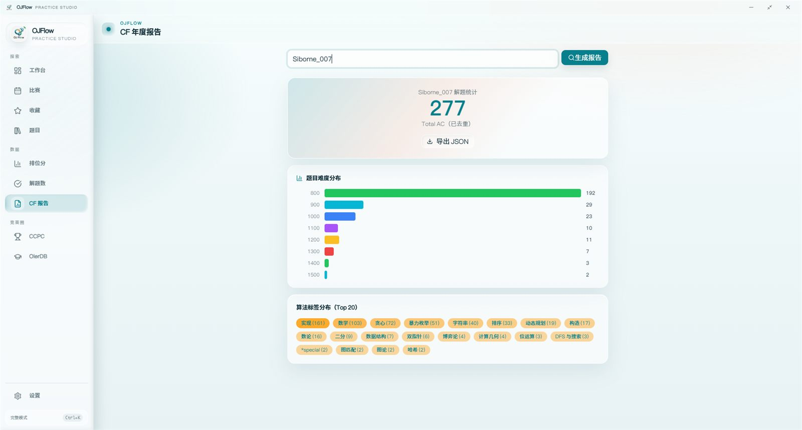

<div align="center">
  
  <h1>OJFlow</h1>
  <p><strong>把比赛、Rating、题目和训练计划放进同一个桌面工作台。</strong></p>
  <p>面向算法竞赛选手的开源多平台 OJ 数据工具</p>

  <p>
    <a href="https://siborne.top/OJFlow/"><strong>官网</strong></a>
    ·
    <a href="https://github.com/Siborne/OJFlow/releases/latest"><strong>下载最新版</strong></a>
    ·
    <a href="docs/releases/v1.5.0.md">更新日志</a>
    ·
    <a href="https://github.com/Siborne/OJFlow/issues">问题反馈</a>
  </p>

  <a href="https://github.com/Siborne/OJFlow/actions/workflows/ci.yml"></a>
  <a href="https://siborne.top/OJFlow/"></a>
  <a href="https://github.com/Siborne/OJFlow/releases"></a>
  <a href="./LICENSE"></a>
</div>

> **产品官网：[https://siborne.top/OJFlow/](https://siborne.top/OJFlow/)**<br />
> 当前版本：**v1.5.0**，支持 Windows、macOS 和 Linux。

OJFlow 把 Codeforces、AtCoder、LeetCode、洛谷、牛客、蓝桥云课、VJudge、HDU、POJ 和
QOJ 的比赛、Rating、解题数据、题目检索、练习草稿、代码模板与训练日程集中到一个桌面工作台。
打开应用时，你看到的不只是几张查询表，而是“今天有什么比赛、该练什么、进度怎么样”。

## 界面预览

<table>
  <tr>
    <td width="50%">
      
      <br />
      <strong>数据工作台</strong>
      <br />
      Rating、解题分布、做题树、比赛和日程统一呈现。
    </td>
    <td width="50%">
      
      <br />
      <strong>多平台比赛</strong>
      <br />
      按今天、明天、本周或全部查看，支持收藏和日程联动。
    </td>
  </tr>
  <tr>
    <td width="50%">
      
      <br />
      <strong>跨平台题目检索</strong>
      <br />
      多平台题库联合搜索，支持中文标签、难度和来源筛选。
    </td>
    <td width="50%">
      
      <br />
      <strong>CF 训练报告</strong>
      <br />
      查看难度分布、算法标签和训练统计，并导出数据。
    </td>
  </tr>
</table>

## 你可以用它做什么

### 比赛不再散落在十几个标签页

- 聚合十个 OJ 平台的近期比赛，缓存优先、后台刷新。
- 按今天、明天、本周或全部快速筛选，并查看平台覆盖情况。
- 收藏比赛后自动生成日程，取消收藏时同步移除关联日程。
- 点击比赛即可进入原平台参赛页，日程也会显示平台 Logo 和完成状态。
- 收藏比赛可以直接启动 VP 计时器，支持暂停、继续和跨重启恢复。

### 从刷题到复习形成闭环

- 跨平台检索 Codeforces、AtCoder、力扣、洛谷、牛客和 QOJ 题目。
- 内置 76+ 中英算法标签字典，中文显示不会影响平台原始 API 筛选。
- 通过 Competitive Companion 从浏览器一键导入题面、样例、限制、笔记和练习状态。
- 练习收件箱支持待开始、练习中、待复习和已完成四种状态，数据跨重启保留。
- 每道题都有独立代码草稿、语言选择和练习笔记，并支持手动添加题目与样例。
- 内置代码模板库，可按标题、语言、分类和内容搜索，一键复制常用板子。

### 日程和模板都有独立入口

- 独立日程页集中查看今天、待进行、已完成和已过期安排，并支持一键清理过期日程。
- 工作台默认只显示今天的日程，也可以在设置中切换为“今天及未来”。
- 模板库支持全局快捷键，从其他应用直接呼出 OJFlow 并打开模板页面。
- 工作台日程卡使用固定高度和内部滚动，不会再把旁边的数据卡撑高。

### 把训练成果变成一张数据海报

- 从工作台导出 1200×1500 PNG，不依赖普通页面截图。
- 海报可包含 Rating、平台分布、训练主题和已完成日程。
- 提供浅色报告、深色数据和极光渐变三种样式。
- 可在设置中选择海报包含哪些模块，避免分享不必要的信息。

### 每次打开都接着上次继续

- 比赛、Rating、解题数和 CF 报告查询快照持久化到本地 SQLite。
- 工作台优先显示上次数据，不必每次先看空白页面等待请求。
- 工作台、排位分、解题数和 CF 报告可分别配置自动刷新。
- 自动刷新间隔支持 5、15、30、60 分钟，关闭的模块不会重复请求。

### 界面可以真正按你的习惯调整

- 简洁模式和完整模式提供不同信息密度。
- 7 套强调色，支持亮色、暗色和跟随系统。
- 玻璃拟态、平铺、云雾和粘土四种界面质感。
- 中文、英文和跟随系统三种语言策略。
- 无边框窗口、自绘窗口按钮、托盘常驻、开机自启和自定义关闭行为。

## 支持平台

| 平台 | 比赛 | Rating | 解题数 | 题目检索 |
| --- | :---: | :---: | :---: | :---: |
| Codeforces | 支持 | 支持 | 支持 | 支持 |
| AtCoder | 支持 | 支持 | 支持 | 支持 |
| LeetCode / 力扣 | 支持 | 支持 | 支持 | 支持 |
| 洛谷 | 支持 | 支持 | 支持 | 支持 |
| 牛客 | 支持 | 支持 | 支持 | 支持 |
| 蓝桥云课 | 支持 | - | 支持 | - |
| VJudge | 支持 | - | 支持 | - |
| HDU | 支持 | - | 支持 | - |
| POJ | 支持 | - | 支持 | - |
| QOJ | - | - | 支持 | 支持 |

> 部分平台需要填写公开用户名或 ID。解题数页面内置了蓝桥云课、牛客和力扣的获取说明。

## 下载与安装

前往 [GitHub Releases](https://github.com/Siborne/OJFlow/releases/latest) 下载最新版本：

| 系统 | 安装包 |
| --- | --- |
| Windows | `.exe` |
| macOS | `.dmg` / `.zip` |
| Linux | `.AppImage` / `.deb` |

应用支持启动时自动检查更新。下载和安装仍需要你确认，不会静默更新。

## 快速开始

1. 安装并打开 OJFlow。
2. 在“解题数”和“排位分”中填写你的平台用户名，查询结果会保存在本机。
3. 在“比赛”中收藏感兴趣的比赛，应用会自动生成关联日程。
4. 安装 Competitive Companion 浏览器扩展，在支持的 OJ 题目页点击扩展图标，即可把题目导入练习收件箱。
5. 在“模板库”中保存常用板子，并设置全局快捷键快速呼出。
6. 在工作台查看训练统计，或导出训练数据海报分享你的学习成果。

## 数据与隐私

- 不需要注册 OJFlow 账号。
- 设置、收藏、日程、练习收件箱和代码模板保存在本机。
- 比赛、Rating 和解题数查询快照保存在本地 SQLite 数据库。
- 网络请求由 Electron 主进程发起，渲染进程不直接获得 Node.js 权限。
- 清理缓存时会同时清理内存缓存、本地设置缓存和 SQLite 查询快照。

## 常见问题

**为什么某个平台暂时没有数据？**

平台接口可能限流、调整字段或要求公开主页。OJFlow 会保留其他平台结果，并在界面上标记异常来源。

**为什么洛谷或牛客没有显示 Rating？**

只有公开 Rating 的账号才会显示分数；没有公开数据时会按 0 降级，不会阻塞其他平台。

**Competitive Companion 没有收到题目怎么办？**

确认 OJFlow 正在运行，并检查浏览器扩展是否允许访问本机端口。OJFlow 的接收服务只监听本机。

**如何减少后台请求？**

在设置中关闭不需要的自动刷新模块，或把刷新间隔调整为 30/60 分钟。

## 关于项目

OJFlow 是开源桌面应用，参考了 [oj_helper](https://github.com/2754LM/oj_helper)
的接口与产品思路，并使用 React 和 Electron 重新实现。

项目采用 [GPL-3.0-only](./LICENSE) 许可证。

<details>
<summary><strong>开发者：本地运行与质量门禁</strong></summary>

技术栈：Electron 30、React 18、TypeScript Strict、Zustand、Tailwind CSS 4、SQLite 和 Bun。

```bash
bun install
bun run dev
```

提交前运行完整质量门禁：

```bash
bun run verify
```

它会执行 TypeScript、ESLint、Prettier、官网静态检查、单元测试、真实 Electron E2E 和生产构建。

</details>

<div align="center">
  <sub>Built for people who would rather solve one more problem than manage ten tabs.</sub>
</div>
