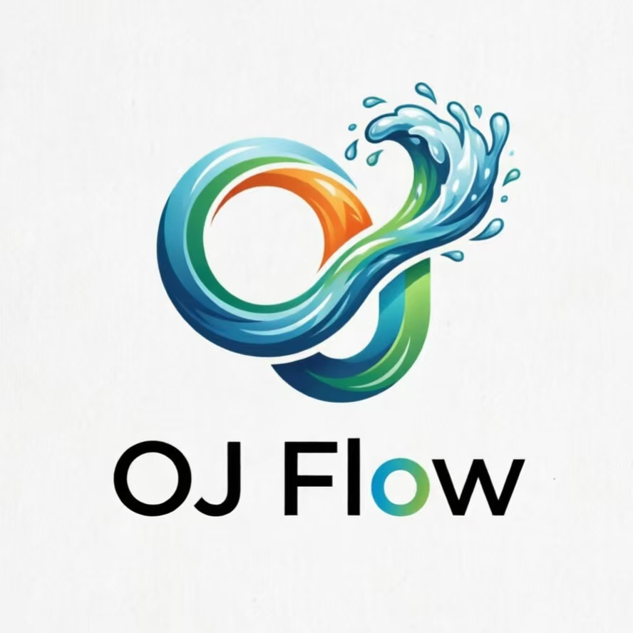

<div align="center">
  
  <h1>OJFlow</h1>
  <p><strong>Stay in the zone, skip the clutter.</strong></p>
  <p>面向算法竞赛选手的多平台数据工作台</p>

  <p>
    <a href="https://siborne.top/OJFlow/"><strong>官网</strong></a>
    ·
    <a href="https://github.com/Siborne/OJFlow/releases/latest"><strong>下载</strong></a>
    ·
    <a href="https://github.com/Siborne/OJFlow/issues">问题反馈</a>
  </p>

  <a href="https://github.com/Siborne/OJFlow/actions/workflows/ci.yml"></a>
  <a href="https://siborne.top/OJFlow/"></a>
  <a href="https://github.com/Siborne/OJFlow/actions/workflows/release.yml"></a>
  <a href="./LICENSE"></a>
</div>

> 产品官网：[**https://siborne.top/OJFlow/**](https://siborne.top/OJFlow/)

OJFlow 把 Codeforces、AtCoder、LeetCode、洛谷、牛客、蓝桥云课、VJudge、HDU、POJ 和
QOJ 的比赛、Rating、解题数据、题目检索与训练日程集中到一个桌面工作台。


## 为什么是 OJFlow

大多数 OJ 工具解决“查一次数据”。OJFlow 解决的是“今天应该做什么”。

- **Bento 数据工作台**：比赛、Rating、历史解题量、算法主题树、平台分布和日程同屏呈现。
- **十平台比赛聚合**：缓存优先、后台刷新，单平台失败不会阻塞其他平台。
- **跨平台题目检索**：Codeforces、AtCoder、力扣、洛谷、牛客和 QOJ 联合检索。
- **中英算法标签字典**：76+ 标签支持中英文显示、别名归一化和稳定的英文 API 值。
- **收藏与日程联动**：关注比赛自动生成日程，取消关注同步移除自动日程。
- **SQLite 查询快照**：比赛、Rating 和解题数持久化到本地数据库，重启后仍有上下文。
- **数据大屏式统计**：分段环图、平台排行、平均解题数和主力平台一屏呈现。
- **个性化界面**：7 套配色、玻璃/平铺/云雾/粘土 4 种质感、亮色/暗色/跟随系统。
- **完整桌面体验**：无边框窗口、自绘窗口按钮、托盘常驻、开机自启和可配置关闭行为。

## 支持平台

| 平台 | 比赛 | Rating | 解题数 | 题目检索 |
| --- | :---: | :---: | :---: | :---: |
| Codeforces | ✓ | ✓ | ✓ | ✓ |
| AtCoder | ✓ | ✓ | ✓ | ✓ |
| LeetCode / 力扣 | ✓ | ✓ | ✓ | ✓ |
| 洛谷 | ✓ | ✓ | ✓ | ✓ |
| 牛客 | ✓ | ✓ | ✓ | ✓ |
| 蓝桥云课 | ✓ |  | ✓ |  |
| VJudge | ✓ |  | ✓ |  |
| HDU | ✓ |  | ✓ |  |
| POJ | ✓ |  | ✓ |  |
| QOJ |  |  | ✓ | ✓ |

## 截图与官网

官网包含完整产品介绍、交互式配色/质感预览和下载入口：

**[https://siborne.top/OJFlow/](https://siborne.top/OJFlow/)**

官网源码位于 [`site/`](./site)，通过 GitHub Pages 自动部署。

## 下载

前往 [GitHub Releases](https://github.com/Siborne/OJFlow/releases/latest) 获取最新版本：

- Windows：`.exe`
- macOS：`.dmg` / `.zip`
- Linux：`.AppImage` / `.deb`

## 技术栈

- Electron 30 + React 18 + TypeScript Strict
- Zustand + TanStack Query + React Router
- Tailwind CSS 4 + Radix UI
- SQLite（`sql.js` WASM）查询快照
- Bun + Vite
- Playwright 真实 Electron E2E

## 本地开发

要求 Node.js 20+、Bun 1.3+。

```bash
bun install
bun run dev
```

`bun run dev` 会先编译 Electron 主进程，再启动 Vite 与 Electron。

## 构建

```bash
bun run build:electron
bun run build
bun run dist

bun run dist:win
bun run dist:mac
bun run dist:linux
```

## 质量门禁

每个模块和用户可见功能都有测试。提交前运行完整门禁：

```bash
bun run verify
```

它会依次执行：

1. TypeScript 类型检查
2. ESLint
3. Prettier 格式检查
4. 官网静态资源与链接检查
5. 单元/组件测试
6. 真实 Electron E2E
7. Electron 主进程与渲染进程生产构建

也可以单独运行：

```bash
bun run type-check
bun run lint
bun run format:check
bun run site:check
bun run test:unit
bun run test:e2e
```

## CI / CD

- [`ci.yml`](./.github/workflows/ci.yml)：每次 push 和 PR 执行类型、Lint、格式、官网、
  单测、构建和真实 Electron E2E。
- [`release.yml`](./.github/workflows/release.yml)：主分支每次推送自动构建三平台安装包并保留
  14 天 Artifact；推送 `v*` tag 或手动触发时上传 Release Assets。
- [`pages.yml`](./.github/workflows/pages.yml)：主分支更新 `site/` 后自动部署 GitHub Pages。

## 数据与持久化

- UI 设置、收藏、日程和平台账号使用 `electron-store` 持久化。
- 比赛、Rating、解题数查询快照写入
  `app.getPath('userData')/ojflow.sqlite`。
- 清理缓存时会同时清理内存缓存、electron-store 缓存和 SQLite 查询快照。

## 安全边界

- 渲染进程不启用 Node.js，`contextIsolation` 保持开启。
- 渲染进程只使用白名单 `window.api`。
- 外部链接仅允许 HTTP(S)。
- 更新包仅允许 HTTPS，localhost 开发例外。
- 持久化存储键经过白名单校验。

## 目录

```text
src/                  React 渲染进程
electron/             主进程、preload、适配器、SQLite 与缓存
shared/               IPC 与领域类型
tests/unit/           Bun 单元/组件测试
tests/e2e/            Playwright Electron E2E
site/                 产品官网静态站点
docs/                 产品、设计与发布文档
```

## 致谢

接口和产品行为参考了 [oj_helper](https://github.com/2754LM/oj_helper)。
本项目采用 [GPL-3.0-only](./LICENSE)。

<div align="center">
  <sub>Built for people who would rather solve one more problem than manage ten tabs.</sub>
</div>
